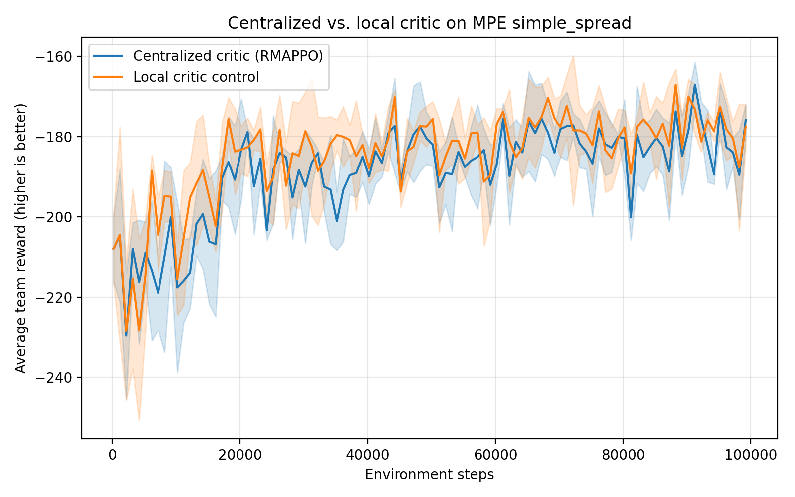

# MAPPO 小规模复现实验：MPE simple_spread

本项目基于论文 [The Surprising Effectiveness of PPO in Cooperative Multi-Agent Games](https://arxiv.org/abs/2103.01955) 的官方实现，完成了一个小规模的 MAPPO/RMAPPO 复现实验。

## 项目目标

在 MPE 的 `simple_spread` 协作环境中，验证多智能体 PPO 能否通过训练提升团队奖励，并比较两种 Critic：

- **集中式 Critic（RMAPPO）**：训练时可以看到所有智能体的全局信息；
- **局部 Critic 对照组**：训练时只看各自的局部信息。

Actor 在两组实验中始终只依据自己的局部观测执行动作。

## 实验设置

- 环境：MPE `simple_spread`
- 智能体数量：3
- 并行环境数量：8
- 总环境步数：100,000
- 随机种子：1、2、3
- 训练设备：NVIDIA GPU
- 算法：RMAPPO（带 RNN 的 PPO）

## 实验结果

三次随机种子的汇总结果：

| 方法 | 最后平均团队奖励 | 标准差 |
|---|---:|---:|
| 集中式 Critic（RMAPPO） | -175.91 | 3.96 |
| 局部 Critic 对照组 | -177.55 | 5.37 |

奖励越接近 0 越好。



在当前小规模实验中，两种 Critic 的表现接近；集中式 Critic 的最终平均奖励略高，且波动略小。

## 结论与限制

本实验支持以下观察：

- RMAPPO 在三个随机种子下都能提升团队平均奖励；
- 集中式 Critic 与局部 Critic 的曲线高度重叠；
- 集中式 Critic 在本次实验中略更稳定，但差异较小。

这不是论文完整复现。论文使用的训练规模更大；本项目是用于学习 MAPPO 原理和复现实验流程的小规模控制实验。

## 项目结构

```text
scripts/      训练脚本
analysis/     日志读取、平均曲线和对比图生成脚本
figures/      实验结果图与汇总 CSV
README.md     项目说明
```

## 运行训练

在项目根目录的 PowerShell 中运行，例如：

```powershell
powershell.exe -ExecutionPolicy Bypass -File ".\scripts\run_mpe_parallel8_100k.ps1"
```

局部 Critic 对照组：

```powershell
powershell.exe -ExecutionPolicy Bypass -File ".\scripts\run_localcritic_parallel8_100k_seed1.ps1"
```

## 致谢

原始 MAPPO 代码来自 [marlbenchmark/on-policy](https://github.com/marlbenchmark/on-policy)。