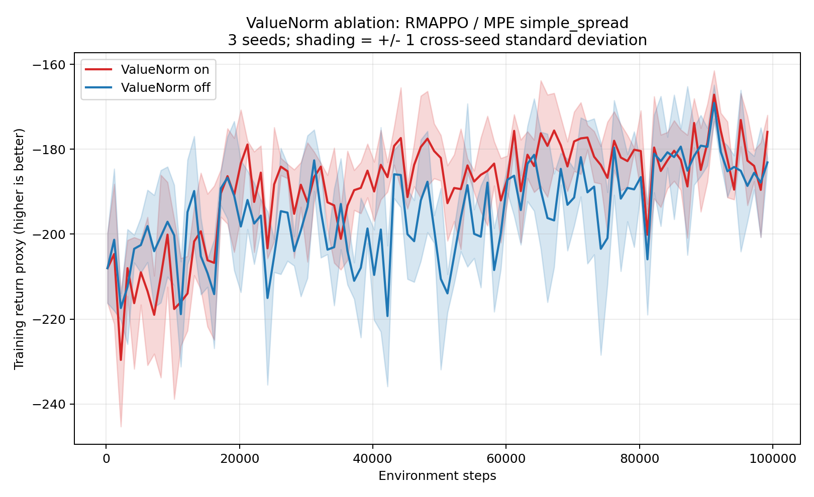

# MAPPO 小规模复现实验：MPE simple_spread

本项目基于论文 [The Surprising Effectiveness of PPO in Cooperative Multi-Agent Games](https://arxiv.org/abs/2103.01955) 的官方实现，完成了一个小规模的 MAPPO/RMAPPO 复现实验。

## 项目目标

在 MPE 的 `simple_spread` 协作环境中，验证多智能体 PPO 能否通过训练提升团队奖励，并比较两种 Critic：

- **集中式 Critic（RMAPPO）**：训练时可以看到所有智能体的全局信息；
- **局部 Critic 对照组**：训练时只看各自的局部信息。

Actor 在两组实验中始终只依据自己的局部观测执行动作。

## 实验设置

- 环境：MPE `simple_spread`
- 智能体数量：3
- 并行环境数量：8
- 总环境步数：100,000
- 随机种子：1、2、3
- 训练设备：NVIDIA GPU
- 算法：RMAPPO（带 RNN 的 PPO）

## 实验结果

三次随机种子的汇总结果：

| 方法 | 最后平均团队奖励 | 标准差 |
|---|---:|---:|
| 集中式 Critic（RMAPPO） | -175.91 | 3.96 |
| 局部 Critic 对照组 | -177.55 | 5.37 |

奖励越接近 0 越好。


在当前小规模实验中，两种 Critic 的表现接近；集中式 Critic 的最终平均奖励略高，且波动略小。

## 结论与限制

本实验支持以下观察：

- RMAPPO 在三个随机种子下都能提升团队平均奖励；
- 集中式 Critic 与局部 Critic 的曲线高度重叠；
- 集中式 Critic 在本次实验中略更稳定，但差异较小。

这不是论文完整复现。论文使用的训练规模更大；本项目是用于学习 MAPPO 原理和复现实验流程的小规模控制实验。

## 项目结构

```text
scripts/      训练脚本
analysis/     日志读取、平均曲线和对比图生成脚本
figures/      实验结果图与汇总 CSV
README.md     项目说明
```

## 运行训练

在项目根目录的 PowerShell 中运行，例如：

```powershell
powershell.exe -ExecutionPolicy Bypass -File ".\scripts\run_mpe_parallel8_100k.ps1"
```

局部 Critic 对照组：

```powershell
powershell.exe -ExecutionPolicy Bypass -File ".\scripts\run_localcritic_parallel8_100k_seed1.ps1"
```

## 致谢

原始 MAPPO 代码来自 [marlbenchmark/on-policy](https://github.com/marlbenchmark/on-policy)。

## 价值归一化对照实验（论文 5.1，小规模验证）

### 本次更新（2026-10-11）

本次更新发布在原仓库 [zwj-62/mappo-reproduction](https://github.com/zwj-62/mappo-reproduction)，没有新建其他仓库。新增关闭 ValueNorm 的三个独立种子训练脚本、两组对比绘图与独立评估代码、结果 PNG/CSV 和实验记录；之前的集中式/本地 Critic 实验保留不变。

GitHub 上传代码和汇总结果。虚拟环境、官方源码副本、安装包、原始 TensorBoard 日志和模型权重不上传，均保留在本地。浏览本页图片或下载 CSV 可以查看结果；重新读取原始日志绘图、执行模型评估以及运行依赖原始记录的测试，需要本地完整实验目录。公开的 provenance 文件已去除本机绝对路径前缀，完整本地记录仍保留。

研究问题：只改变 Critic 的价值归一化开关，是否影响策略学习？两组都使用集中式 Critic、RNN、8 个并行环境、100k 环境步，不能用之前的本地 Critic 组代替关闭归一化组。

### 1. 每个种子一个训练脚本

文件均在本项目的 `scripts/`，沿用原来的方式：

| 种子 | 开启 ValueNorm（原脚本，保留） | 关闭 ValueNorm（新脚本） |
|---|---|---|
| 1 | `run_mpe_parallel8_100k.ps1` | `run_mpe_parallel8_100k_novaluenorm_seed1.ps1` |
| 2 | `run_mpe_parallel8_100k_seed2.ps1` | `run_mpe_parallel8_100k_novaluenorm_seed2.ps1` |
| 3 | `run_mpe_parallel8_100k_seed3.ps1` | `run_mpe_parallel8_100k_novaluenorm_seed3.ps1` |

原因：逐种子检查、运行和对照，避免一个统一入口隐藏实验细节。新脚本与对应原脚本的训练参数只相差实验名和 `--use_valuenorm`。

**开关容易看反：官方代码的 `--use_valuenorm` 使用 `store_false`。不写 = 开启；写上 = 关闭。** 新脚本不改变集中式 Critic、RNN、观测特征归一化、价值裁剪或实际环境奖励。

两组的 10k 步短测试和各三个种子的 100k 步正式训练均已完成。此次只整理文件，没有重新训练，现在不需要再运行训练脚本。

### 2. 看对比图：不用自己找六份日志

在项目根目录的 PowerShell 中，只运行绘图：

```powershell
.\.venv\Scripts\python.exe .\analysis\plot_valuenorm_comparison.py
```

这个脚本不会训练；它对齐六条曲线的共同日志步数，生成三种子平均值与标准差：

- `figures/valuenorm_on_vs_off_3seeds.png`：开启与关闭的平均曲线，阴影为跨种子 ±1 标准差。
- `figures/valuenorm_individual_seeds.png`：两组各自的三条种子曲线。
- `figures/valuenorm_per_seed_summary.csv`：每个种子的最后日志点、末 10 个日志点平均值。
- `figures/valuenorm_on_3seeds.csv` 与 `valuenorm_off_3seeds.csv`：逐步数、逐种子的完整训练曲线数据。



| 方法 | 最后日志点（均值 ± 标准差） | 末 10 个日志点（均值 ± 跨种子标准差） |
|---|---:|---:|
| 开启 ValueNorm | -175.91 ± 3.96 | -179.85 ± 1.86 |
| 关闭 ValueNorm | -183.11 ± 1.03 | -182.87 ± 2.34 |

奖励越高越好。每次实际训练完成 100,000 步，最后一次日志在 99,200 步。末 10 点覆盖 90,200–99,200 步，先对每个种子取平均，再计算跨种子的均值和标准差（`ddof=0`）。这些是训练日志指标，不是独立测试成绩，也不是置信区间。三个种子、100k 步只能做小规模观察，不能据此断言归一化总是更好或已复现论文全部结论。

本次观察：开启组的末 10 点平均成绩高约 3.03，但种子 2 的关闭组更好。最后日志点的跨种子标准差反而是关闭组更小，因此不能简单地把本次结果概括成“开启后一定更稳定”，也没有做显著性检验。

### 3. 原始日志和模型在哪里

统一放回原有目录：

```text
official-source/on-policy-main/onpolicy/scripts/results/MPE/simple_spread/rmappo/
  mpe_spread_rmappo_parallel8_100k_seed1/run2/
  mpe_spread_rmappo_parallel8_100k_seed2/run2/
  mpe_spread_rmappo_parallel8_100k_seed3/run2/
  mpe_spread_rmappo_parallel8_100k_novaluenorm_seed1/run1/
  mpe_spread_rmappo_parallel8_100k_novaluenorm_seed2/run1/
  mpe_spread_rmappo_parallel8_100k_novaluenorm_seed3/run1/
```

开启组的旧 `run1` 属于之前的实验，保留原样；本次复跑保存在 `run2`，避免覆盖。关闭组是新实验，保存在 `run1`。每份 run 内有原始 `logs/`、`models/`、`console.log` 和完整参数记录 `reproduction_record.json`。短测试也保留在同一结果根目录的 `parallel8_10k` 实验中。

这些已完成的训练原先由旧统一入口生成，现仅迁移和整理，没有伪称由新脚本重新训练。记录保留当时的实验名、命令和来源，另标注当前位置。原日志 JSON 中的旧绝对路径只是 TensorBoard 指标名称，不影响读取。

以后手动重跑会产生新 run，不会覆盖旧 run。需要比较新结果时，明确修改 `analysis/plot_valuenorm_comparison.py` 顶部的 `RUN_NUMBERS`，不要把多次训练混在一起。

### 4. 可选：独立评估已保存的 Actor

之前已完成六个模型各 100 个新回合的独立评估，数据保留在 `figures/valuenorm_evaluation_episodes.csv` 和 `valuenorm_evaluation_summary.json`。它使用相同的新环境初始状态、确定性动作，与训练曲线分开报告：开启组 -185.89 ± 0.42，关闭组 -187.32 ± 5.81；开启组并非每个种子都更好。

若需要重做评估（不训练），运行：

```powershell
.\.venv\Scripts\python.exe .\analysis\evaluate_valuenorm.py
```

环境、源码哈希、迁移映射及之前的检查结果保存在 `figures/valuenorm_provenance.json`。检查绘图数据读取逻辑可以运行：

```powershell
.\.venv\Scripts\python.exe -m unittest discover -s analysis -p test_valuenorm_comparison.py -v
```
